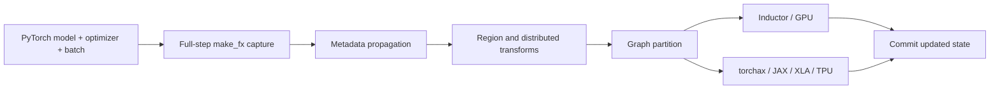

# RecIR design

## Overview

RecIR compiles a stateful PyTorch recommendation training step into a unified
FX graph and lowers that graph to multiple execution backends. The captured
step includes model forward, loss computation, backward, and optimizer updates.
This makes the graph — rather than a backend-specific model wrapper — the
source of truth for execution.

The first supported reference is DLRMv3 training on GPU and TPU:

```text
                         ┌─ GPU transforms ─ Inductor ─ CUDA
PyTorch train step ─ FX ─┤
                         └─ GSPMD transforms ─ torchax ─ JAX/XLA ─ TPU
```

RecIR is not a new modeling framework. Models remain ordinary `torch.nn.Module`
objects, optimizers remain PyTorch optimizers, and inputs remain PyTorch
pytrees. RecIR owns capture, graph transformation, state management,
distribution, and backend lowering.

## Goals

- Express model math once in PyTorch and execute it on GPU or TPU.
- Capture the complete state transition of one training step.
- Keep sharding, padding, recomputation, and backend optimizations outside the
  model definition.
- Support recommendation-specific sparse and jagged operators.
- Make graph transformations composable and independently testable.
- Preserve an eager control path for numerical parity and debugging.

## Non-goals for the first release

- A stable API for every module in the repository.
- Transparent compilation of arbitrary dynamic Python control flow.
- Identical performance characteristics across hardware backends.
- A production serving or model-publishing contract.
- Hiding backend limitations: static shapes and supported sparse optimizer
  combinations remain explicit.

## User-facing execution model

A train step is an ordinary Python function:

```python
def train_step(model, optimizer, batch):
    losses, outputs = model(batch)
    losses.sum().backward()
    optimizer.step()
    return losses, outputs
```

`recir.compile()` turns a function like this into a runner. Higher-level helpers
in `recir.training` build the parallel mode, optimizer state, example inputs,
and backend for a complete application. The DLRMv3 reference uses
`compile_hdp_step()` for GPU and `compile_gspmd_step()` for TPU.

The runner owns a state transition:

```text
(model state, optimizer state, input batch)
                    │
                    ▼
             compiled FX graph
                    │
                    ▼
(updated model state, updated optimizer state, outputs)
```

Parameters, buffers, and optimizer tensors are lifted into graph inputs.
Updates are returned from the graph and committed by the runtime state manager.
This avoids treating mutation as an opaque side effect.

## Compilation pipeline

The orchestration lives in `recir/api.py`. The pipeline is conceptually split
into the following stages.

### 1. Prepare state and inputs

RecIR flattens Python pytrees, discovers model and optimizer state, associates
state tensors with stable fully qualified names, and creates fake tensors for
capture. Batch and state inputs receive metadata used by later sharding passes.

### 2. Capture the full step

`make_fx` records ATen operations for forward, backward, and optimizer logic.
RecIR uses decompositions for composite operations when doing so preserves the
semantics needed by downstream backends.

The result is a `torch.fx.GraphModule` whose placeholders represent explicit
inputs and lifted state.

### 3. Normalize and annotate

Graph metadata records information that is not reliably recoverable from
tensor shapes alone:

- batch dimensions;
- parameters and optimizer state;
- graph boundaries and marked regions;
- device placement; and
- ownership of values across partitioned subgraphs.

These annotations drive distribution and lowering. Passes validate their
invariants rather than silently guessing when an input is ambiguous.

### 4. Apply graph transforms

Transforms rewrite the backend-independent graph. Examples include:

- inserting distributed collectives;
- padding dynamic recommendation batches to compile-time shapes;
- recomputing activations in backward;
- replacing training operators with inference equivalents;
- routing sparse embeddings; and
- partitioning work into pipeline stages.

### 5. Partition and lower

The transformed graph is segmented into independently lowered graph modules.
GPU segments lower through PyTorch/Inductor. TPU segments translate ATen
operations through the bundled torchax integration into JAX operations and are
compiled by XLA.

### 6. Execute and commit state

The runtime prepares flattened inputs, invokes the lowered graph, commits
updated state tensors, and reconstructs the user-visible output pytree.



## Parallel modes

Parallel modes describe distribution separately from model code.

### DataParallel

Model parameters are replicated and dense gradients are reduced across ranks.
The graph contains the collectives required for the selected execution path.

### HybridParallel

Dense parameters use data parallelism while large embedding tables follow an
`EmbeddingShardingPlan`. The GPU DLRMv3 reference uses this mode with Inductor
and optionally lowers sparse tables to FBGEMM TBE.

### GSPMDParallel

Tensor sharding is expressed as XLA partition specifications. XLA inserts the
required collectives for standard dense computation. Operators requiring
precise communication placement can use `shard_map` inside their JAX lowering.

## Region transforms

A region transform identifies a coherent subgraph and replaces it with a
wrapper that changes its execution behavior while preserving its interface.
This is the primary abstraction for backend-independent optimizations.

Examples in `recir/region_transforms` include:

- padding and unpadding;
- activation recomputation;
- training-to-inference conversion;
- sparse embedding routing;
- dropout PRNG handling; and
- state regather and redistribution.

Region transforms operate on FX graphs and can therefore be validated without
changing the original model class.

## Non-traceable components and overrides

Some recommendation components use data-dependent control flow, host
synchronization, or libraries without FakeTensor support. An override handles
these components in two phases:

1. Before capture, install a traceable stand-in that preserves shapes and data
   dependencies.
2. After capture, replace the stand-in region with the intended runtime
   implementation or a backend-specific custom operator.

Overrides are explicit escape hatches. They keep non-traceable behavior local
instead of teaching the core tracer about individual models.

## Sparse embeddings

Embedding storage and update policy are exposed through the
`EmbeddingBackend` interface.

### GPU

The DLRMv3 GPU path builds a TorchRec sharding plan. Large tables can be
row-wise sharded and lowered to FBGEMM TBE with fused RowWiseAdagrad; smaller
tables can remain replicated. Dense and sparse optimizers are represented as
one logical step even when their runtime implementations differ.

### TPU

The default TPU reference keeps embedding tables inside the GSPMD program.
Tables are row-sharded and looked up through a Pallas ring-shift protocol that
routes IDs and results without materializing a global table. Sparse optimizer
updates are compiled into the graph.

A CPU embedding backend is available for host-only debugging, but it is not a
performance model of TPU execution.

## Static shapes and token-budget batching

XLA compilation benefits from stable shapes, while recommendation histories
are naturally jagged. DLRMv3 uses token-budget batching:

- real samples keep their individual history lengths;
- the total tokens per block are fixed;
- dummy rows absorb unused token capacity; and
- dummy candidates carry zero training weight.

This preserves jagged attention semantics while producing stable compiled
shapes. Padding is part of the execution strategy, not the model definition.

## Numerical parity

Every backend should be compared with an eager PyTorch control using the same
initial state and deterministic batches. The DLRMv3 reference compares:

- per-task losses;
- model outputs;
- a selected gradient probe;
- parameters after each step; and
- optimizer state.

GPU and TPU have separate tolerance controls because their kernels and default
dtypes differ. A parity run fails when any checked tensor exceeds the declared
tolerance; it does not rely only on a scalar loss trend.

## DLRMv3 reference flow

The reference model shares `common/model.py`, `common/data.py`, configuration,
metrics, and train/eval step definitions.

```text
public dataset or debug generator
              │
              ▼
      TokenBudgetCollate
              │
              ▼
        DlrmV3TrainModule
          │             │
          ▼             ▼
   GPUTrainer       TPUTrainer
   HybridParallel   GSPMD
   Inductor/TBE     torchax/XLA/ring shift
```

Backend-specific files contain execution setup, not a second model
implementation. This shared-model property is the central acceptance criterion
for the first RecIR release.

## Extending RecIR

Choose the narrowest extension point that matches the problem:

- add a decomposition for a composite PyTorch operator;
- add a torchax mapping for an ATen operator with a direct JAX equivalent;
- add a custom operator and lowering for specialized kernels;
- add a region transform for a graph-level optimization;
- add an override for non-traceable model components; or
- add an embedding backend for a new storage/update system.

New extensions should include an eager reference, FakeTensor coverage, graph
structure assertions, numerical tests, and backend-specific tests where
hardware is required.

## Current limitations

- Python data-dependent control flow is not captured automatically.
- Shape-changing workloads need an explicit padding or bucketing strategy.
- Operator coverage differs between Inductor and torchax/XLA.
- Some sparse optimizer and checkpoint combinations are backend-specific.
- Pipeline scheduling assumes a linear sequence of stages.
- The inference path is experimental and is not part of the first DLRMv3
  support contract.

## Source map

| Area | Source |
| --- | --- |
| Capture and orchestration | `recir/api.py` |
| Parallel modes | `recir/distributed/` |
| Graph transforms | `recir/region_transforms/` |
| Embedding backends | `recir/embedding/` |
| GPU/TPU lowering | `recir/lowering/`, `recir/torchax/` |
| Training state and optimizers | `recir/training/` |
| End-to-end reference | `recir/examples/dlrmv3/` |
