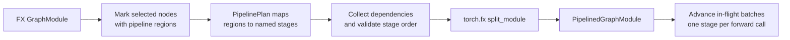
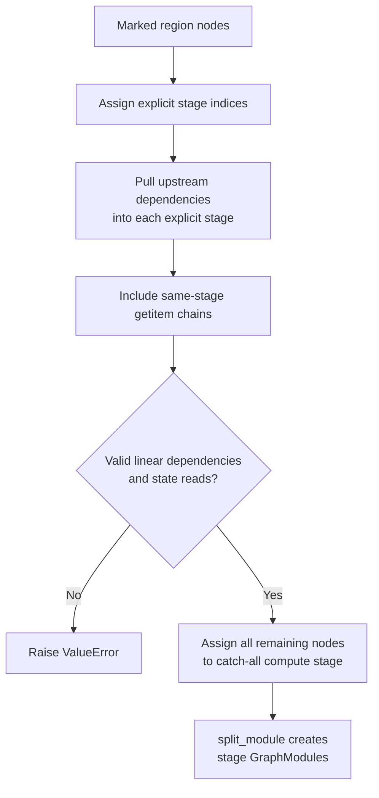
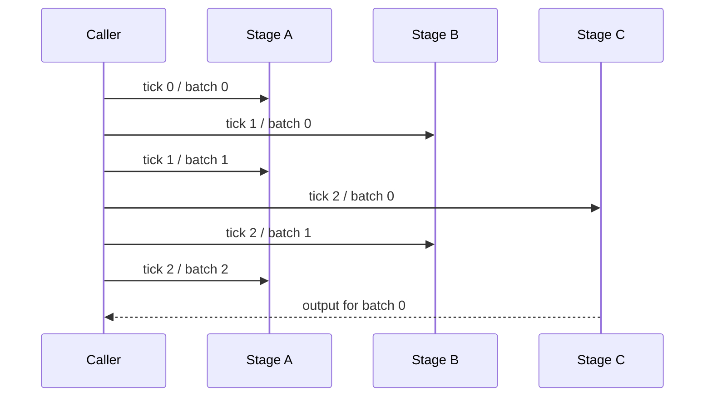
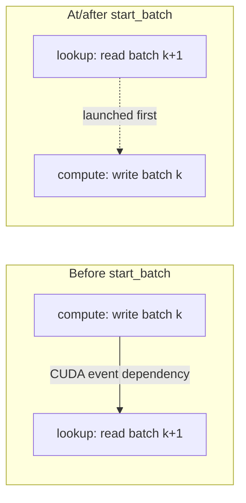

# Recir FX Device Pipeline Design

This document explains the pipeline implemented by
[`pipeline.py`](../recir/pipeline.py) and the ready-made plans in
[`pipeline_strategies.py`](../recir/pipeline_strategies.py).

The pipeline overlaps work from different batches across a linear sequence of
FX graph stages. Graph partitioning decides **what belongs to each stage**;
the runtime schedule decides **which already-ready stage action runs first in
each pipeline tick**.

## High-level flow



There are two distinct phases:

1. **Build time:** `build_pipeline()` partitions one FX graph into ordered
   stage `GraphModule`s.
2. **Run time:** `PipelinedGraphModule.forward()` maintains in-flight batch
   slots and advances each occupied slot by one stage.

## Configuration model

### Regions

`mark_pipeline_region(nodes, region)` attaches a region identifier to FX node
metadata. A node may be marked repeatedly with the same region, but assigning
it conflicting regions is rejected.

`PipelineRegion` defines the regions used by the built-in strategies:

| Region | Intended work |
| --- | --- |
| `PREPROCESS` | Input preprocessing associated with routing |
| `ROUTE_START` | Initial routing/data-distribution work |
| `ROUTE_CONTINUE` | Remaining routing/data-distribution work |
| `EMBEDDING_LOOKUP` | State-reading embedding lookup |

Regions describe semantic parts of the original graph. They do not directly
determine runtime order; a `PipelinePlan` groups them into ordered stages.

### Stage specifications

Each `PipelineStageSpec` declares one of two kinds of stage:

- A region stage owns one or more `regions` and may declare a subset as
  `required_regions`.
- The final catch-all stage sets `include_unassigned_nodes=True` and contains
  everything not assigned to an earlier stage.

`allow_state_reads=True` permits a stage to consume placeholders marked with
`node.meta["is_weight"]`. This is intentionally opt-in so data-distribution
stages cannot accidentally read model or optimizer state.

A valid `PipelinePlan` has unique stage names, assigns each region to at most
one stage, and has exactly one catch-all stage in the final position. An
optional region stage with no matching nodes is omitted from the built graph.

### Config

`PipelineConfig.none()` leaves the graph unchanged. `PipelineConfig.from_plan()`
enables the pipeline. Although the config exposes
`gradient_accumulation_steps`, values other than `1` are currently rejected by
`build_pipeline()` because accumulation-aware scheduling is not implemented.

## How graph partitioning works

`build_pipeline()` performs the following steps:

1. `_collect_pipeline_stages()` matches marked nodes to the plan's region
   stages. It checks required regions and omits empty optional stages.
2. For every explicitly assigned node, `_assign_stage_dependencies()` walks
   backward through its inputs. Ordinary upstream computation is pulled into
   the same stage until a placeholder or `get_attr` boundary is reached.
3. `_assign_stage_getitems()` keeps chains of `operator.getitem` nodes with
   their producing stage. This preserves tuple/list unpacking around stage
   outputs.
4. `_validate_pipeline_stages()` rejects backward dependencies on a later
   stage and unauthorized reads of weight/state placeholders.
5. Every remaining node is assigned to the final catch-all compute stage.
6. `torch.fx.passes.split_module.split_module()` creates one child
   `GraphModule` per non-empty partition and a wrapper graph that calls them.
7. `PipelinedGraphModule` validates that partition indices are contiguous and
   that at least two stages remain.



The split wrapper can contain plumbing nodes outside the child stage calls,
such as `get_attr`, `getitem`, or output reconstruction. `_build_segments()`
associates those wrapper nodes with a stage:

- a node driven by stage outputs follows the latest parent stage;
- a `get_attr` node used by stages is associated with its earliest user; and
- the output node belongs to the final stage.

As a result, each runtime segment contains both its child stage call and any
wrapper operations that must execute alongside it.

## Runtime execution model

For `N` stages, the module owns `N - 1` internal slots. A slot contains:

- the FX environment for one batch (`FX node → runtime value`);
- a monotonically increasing batch index; and
- the most recent CUDA completion event, when running on CUDA.

On each `forward()` call:

1. Every occupied slot is exposed as a ready `PipelineAction(stage_index,
   batch_index, stage_name)`.
2. The schedule returns an ordering containing every ready action exactly
   once.
3. Each ready batch advances by exactly one stage. A final-stage batch retires
   and becomes this call's result; other batches move to the next slot.
4. Unless `last_iter=True`, the new arguments are admitted as a fresh batch
   and stage 0 runs.
5. If no batch retired, the call returns the sentinel `PIPELINE_PENDING`.

Call `is_pipeline_pending(result)` instead of depending on the sentinel's
implementation type.

### Three-stage example

With stages `A → B → C`, the default schedule produces this timeline:

| `forward()` call | Stage C | Stage B | Stage A | Return value |
| ---: | --- | --- | --- | --- |
| 0 | — | — | batch 0 | pending |
| 1 | — | batch 0 | batch 1 | pending |
| 2 | batch 0 | batch 1 | batch 2 | output 0 |
| 3 | batch 1 | batch 2 | batch 3 | output 1 |

The result is delayed by `N - 1` calls. At steady state, one new batch enters
and one old batch retires per call.

To drain the pipeline, call `forward(last_iter=True)` once per remaining tick
until `has_pending` is false. Drain calls do not admit a new batch, so their
positional arguments are ignored.



## Scheduling contract

`PipelineSchedule` does not move slots or execute stages. It has two hooks:

- `order_actions(ready_actions)` chooses the launch order for the current
  tick. The default orders higher stage indices first, so work closest to
  retirement launches first.
- `dependencies(action, ready_actions)` declares same-tick dependencies. A
  dependency must appear earlier in the returned ordering; otherwise runtime
  validation fails. Its recorded CUDA event is added to the dependent action's
  wait set.

A custom schedule must return every ready action exactly once. It cannot skip,
duplicate, or invent actions.

## CUDA streams and synchronization

When CUDA tensors are present, all non-final stages use one lazily created,
high-priority data-distribution stream. The final stage uses the device's
current stream, which acts as the compute stream.

Each stage:

1. waits for the slot's previous completion event;
2. waits for any same-tick dependency events supplied by the schedule;
3. executes its runtime segment in the selected stream; and
4. records a new event into the slot.

On initial admission, stage 0 waits for the current stream unless the caller
provided `input_ready_event`. Before final-stage compute, non-weight CUDA input
tensors are recorded on the compute stream so their storage lifetime extends
through asynchronous use.

If no CUDA tensor is found in the slot environment, execution is synchronous
and no streams or events are created.

## Built-in plans

### SDD pipeline

`sdd_pipeline_plan()` creates:

```text
route_start [PREPROCESS, ROUTE_START]
    → route_continue [ROUTE_CONTINUE]
    → compute [all unassigned nodes]
```

Both `ROUTE_START` and `ROUTE_CONTINUE` are required. The default schedule
simply prioritizes later stages within each tick.

### Semi-sync pipeline

`semi_sync_pipeline_plan(start_batch=900)` creates:

```text
route_start [PREPROCESS, ROUTE_START]
    → route_continue [ROUTE_CONTINUE]
    → embedding_lookup [EMBEDDING_LOOKUP, state reads allowed]
    → compute [all unassigned nodes, including state update]
```

Its `_BoundedStalenessSchedule` coordinates the `embedding_lookup` state read
with the preceding batch's `compute` state write:

| Writer batch index | Launch order | State-read behavior |
| --- | --- | --- |
| `< start_batch` | compute/write before embedding/read | Read waits for the write event (synchronous) |
| `>= start_batch` | embedding/read before compute/write | Read may observe state before that write (bounded stale) |

The threshold is evaluated using the batch in the `compute` state-write stage.
For example, at `start_batch=900`, the pair containing compute batch 899 still
synchronizes; when compute batch 900 is ready, the next embedding lookup is
launched before it.



Passing an explicit `schedule` to either plan replaces its default. In
particular, supplying one to `semi_sync_pipeline_plan()` opts out of the
bounded-staleness schedule unless the replacement implements equivalent
behavior.

## Stage lowering and inspection

`stage_graph_modules()` returns the ordered child FX modules for inspection.
`lower_stages(lower)` replaces each child `GraphModule` with the `nn.Module`
returned by a caller-provided lowering function while leaving pipeline slot
movement and scheduling intact. `print_readable()` delegates to the split FX
wrapper for debugging.

## Current constraints

- The stage graph is linear; each in-flight batch advances one stage per call.
- At least two non-empty stages must exist after optional stages are removed.
- Gradient accumulation values other than `1` are not implemented.
- New batch inputs are bound positionally to all FX placeholders.
- A schedule controls launch order and same-tick waits, not stage membership or
  the number of stages advanced per tick.
